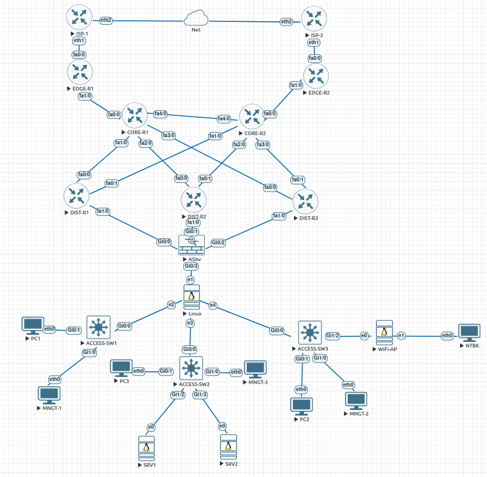

# Portfolio síťových topologií

[](https://www.cisco.com)
[](https://mikrotik.com)
[](https://ubuntu.com)
[](https://www.eve-ng.net/)
[](https://www.netacad.com/courses/packet-tracer)
[](LICENSE)

Portfolio síťových topologií a konfigurací demonstrující praktické dovednosti v oblasti návrhu podnikových sítí, směrování (routing), přepínání (switching), zabezpečení a zpevnění systémů (security hardening) a správy linuxových infrastrukturních služeb.

Repozitář pokrývá jak modulární úlohy na úrovni CCNA, tak rozsáhlou multi-vendor podnikovou kampusovou síť navrženou pro **Cisco Packet Tracer** a **EVE-NG / UNetLab**.

---

## Struktura repozitáře

```
network-topology-portfolio/
├── komplexni-sit/          # Komplexní vícevrstvá podniková síťová topologie
│   ├── README.md           # Podrobná dokumentace topologie & adresní plán
│   └── konfigurace/        # Soubor laboratoře pro EVE-NG (.unl) a konfigurace zařízení
│
└── zaklady/                # Modulární základní úlohy na úrovni CCNA
    ├── vlany/              # 802.1Q VLAN & směrování mezi VLAN (SVI)
    ├── etherchannel/       # Agregace linek (LACP) & ochrana Spanning Tree
    ├── fhrp/               # Protokol redundance první brány (HSRP)
    ├── ospf/               # Dual-Stack OSPFv2 (IPv4) & OSPFv3 (IPv6)
    └── dhcp/               # DHCP Relay & bezpečnost přepínačů na 2. vrstvě
```

---

## 1. Komplexní podniková síť (`komplexni-sit/`)

Multi-vendor podniková síť znázorňující infrastrukturu s redundantními poskytovateli internetu (ISP) s víceúrovňovým zabezpečením (Defense-in-Depth), vysokou dostupností a centralizovanými službami.

### Topologie architektury



### Klíčové vlastnosti
- **Multi-vendor prostředí:** Integruje Cisco IOS (7200, 3725, VIOS L2), Cisco ASAv, MikroTik RouterOS 7 a Ubuntu Linux 20.04.
- **Směrování a redundance:** OSPFv2 Area 0 s kryptografickou autentizací MD5, point-to-point spoji, propagací výchozí cesty (default route injection) a převzetím služeb při výpadku u duálního ISP (failover).
- **Víceúrovňové zabezpečení (Defense-in-Depth):**
  - Control Plane Policing (CoPP) chránící procesory páteřních a distribučních směrovačů.
  - Firewall Cisco ASAv s bezpečnostními úrovněmi (security levels), inspekcí MPF a identity/dynamickým NATem.
  - Linuxový stavový firewall (`iptables`) vynucující striktní segmentaci mezi jednotlivými VLAN.
  - Zabezpečení na 2. vrstvě (L2 hardening): Dynamic ARP Inspection (DAI), DHCP Snooping, Port Security (Sticky MAC), BPDU Guard a izolace nativní VLAN.
  - Zabezpečení síťových prvků: SSHv2, 2048bitové RSA klíče, ochrana proti útokům hrubou silou (`login block-for`) a zakázání nezabezpečených služeb.
- **Podnikové linuxové služby:** ISC-DHCP failover cluster, BIND9 DNS replikace master/slave, FreeRADIUS (AAA) s privilege level 15, NTP synchronizace (Chrony), centralizovaný Rsyslog, SNMPv2c, zálohování konfigurací přes TFTP a interní PKI / Apache HTTPS.

👉 *Podrobnou dokumentaci, tabulky adresních rozsahů a detaily konfigurací naleznete v souboru [`komplexni-sit/README.md`](komplexni-sit/README.md).*

---

## 2. Modulární základní úlohy (`zaklady/`)

Samostatné, cílené praktické úlohy demonstrující konkrétní síťové protokoly a technologie. Každá úloha obsahuje soubor pro Cisco Packet Tracer (`.pkt`), schéma topologie, výpisy konfigurací a dokumentaci.

| Úloha | Zaměření | Klíčové technologie | Složka |
| :--- | :--- | :--- | :--- |
| **VLAN & Inter-VLAN** | Přepínání a L3 směrování | 802.1Q Trunking, SVI na L3 přepínačích, segmentace podsítí | [`zaklady/vlany/`](zaklady/vlany/) |
| **EtherChannel** | Agregace linek & HA | LACP (802.3ad active), šířka pásma 2 Gbps, STP PortFast & BPDU Guard | [`zaklady/etherchannel/`](zaklady/etherchannel/) |
| **FHRP (HSRP)** | Redundance výchozí brány | Cisco HSRP Active/Standby, Preemption, Split-Scope DHCP, Rapid PVST+ | [`zaklady/fhrp/`](zaklady/fhrp/) |
| **Dual-Stack OSPF** | Dynamické směrování | OSPFv2 (IPv4) & OSPFv3 (IPv6), kruhová redundance, P2P spoje, pasivní rozhraní | [`zaklady/ospf/`](zaklady/ospf/) |
| **DHCP & L2 zabezpečení** | Zabezpečení přístupové vrstvy | DHCP Relay, DHCP Snooping, Port Security (Sticky MAC), Rate Limiting, SSHv2 | [`zaklady/dhcp/`](zaklady/dhcp/) |

---

## Přehled dovedností a technologií

- **Směrovací protokoly:** OSPFv2, Dual-Stack OSPFv3, statické a floating trasy, generování výchozí cesty (default route origination)
- **Přepínání a L2 technologie:** VLAN, 802.1Q Trunking, Inter-VLAN Routing (SVI, Router-on-a-Stick), EtherChannel (LACP), Rapid PVST+
- **Redundance výchozí brány:** HSRP (Active/Standby, Preemption, ladění priorit)
- **Zabezpečení a hardening:** Control Plane Policing (CoPP), Dynamic ARP Inspection (DAI), DHCP Snooping, Port Security, Cisco ASAv, Linux iptables, AAA (FreeRADIUS), SSHv2
- **Infrastrukturní služby:** DHCP (Failover & Relay), DNS (BIND9 Master/Slave), NTP (Chrony), Syslog (Rsyslog), SNMP, TFTP, PKI (OpenSSL Root CA), HTTPS (Apache)
- **Platformy a nástroje:** Cisco Packet Tracer, EVE-NG, Cisco IOS, Cisco ASAv, MikroTik RouterOS, Ubuntu Server

---

## Jak laby spustit a prohlížet

- **Cisco Packet Tracer:** Jakýkoli soubor `.pkt` lze přímo otevřít v aplikaci **Cisco Packet Tracer 8.0+**.
- **EVE-NG:** Topologie komplexní podnikové sítě je k dispozici v souboru [`komplexni-sit/konfigurace/topology.unl`](komplexni-sit/konfigurace/topology.unl).
    -**Poznámka:** Na tomto projektu stále pracuji a do tohoto repozitáře nahraji verzi, která bude umožňovat jednodušší spuštění této topologie.
- **Konfigurační soubory:** Čisté textové konfigurační soubory pro všechna zařízení jsou uloženy v podsložce `konfigurace/` u každé úlohy.

---

## Autor a licence

- **Autor:** Lukáš Hajnyš ([hajnys.lukas@gmail.com](mailto:hajnys.lukas@gmail.com))
- **Licence:** MIT License — podrobnosti viz soubor [LICENSE](LICENSE).
