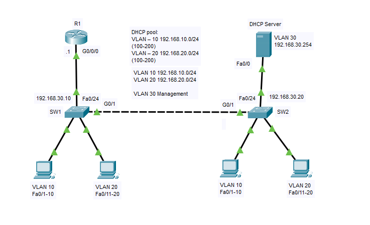

# DHCP a Zabezpečení L2 (Snooping, Port-Security)

Tento projekt demonstruje konfiguraci **DHCP (Dynamic Host Configuration Protocol)** v komplexnějším prostředí s využitím **DHCP Relay** a implementací důležitých bezpečnostních prvků na druhé vrstvě (L2).

## Popis Topologie

Topologie se skládá ze směrovače (**R1**), dvou přepínačů (**SW1**, **SW2**) a dedikovaného **DHCP serveru** umístěného ve správcovské VLAN 30. 

*   **DHCP Relay:** Směrovač R1 přeposílá DHCP požadavky z VLAN 10 a 20 směrem k serveru ve VLAN 30 pomocí funkce `ip helper-address`.
*   **Segmentace:** Síť je rozdělena na VLAN 10 (Uživatelé A), VLAN 20 (Uživatelé B) a VLAN 30 (Management & Server).
*   **Bezpečnost:** Projekt klade velký důraz na ochranu přístupové vrstvy proti běžným útokům.



## Klíčové Vlastnosti

### 1. DHCP Služby
*   **Centralizovaný server:** Správa adres probíhá na jednom místě (VLAN 30).
*   **Helper Address:** Konfigurace na sub-rozhraních R1 umožňující komunikaci klientů se serverem přes hranice broadcastových domén.
*   **Excluded Addresses:** Rezervace statických adres pro brány a servery (rozsah .1 až .99 a .201 až .254).

### 2. L2 Security (Zabezpečení přepínačů)
*   **DHCP Snooping:** Ochrana proti falešným DHCP serverům (Rogue DHCP). Trunk porty jsou nastaveny jako důvěryhodné (`trust`).
*   **Port Security:** Omezení počtu zařízení na portu pomocí **Sticky MAC addresses**. Porty se při detekci nepovoleného zařízení automaticky zablokují.
*   **Rate Limiting:** Omezení počtu DHCP paketů za sekundu na přístupových portech pro prevenci DoS útoků.
*   **BPDU Guard & PortFast:** Zajištění rychlého připojení koncových bodů a ochrana proti nechtěným smyčkám připojením jiného přepínače do uživatelského portu.

### 3. Management
*   **SSH (Secure Shell):** Veškerá správa prvků (R1, SW1, SW2) probíhá šifrovaně přes SSH v2.
*   **Native VLAN:** Změna výchozí VLAN na VLAN 1000 pro zvýšení bezpečnosti trunkových spojů.

## Adresní Plán

| VLAN | Účel | Síť | Brána (R1) | DHCP Rozsah |
| :--- | :--- | :--- | :--- | :--- |
| 10 | Uživatelé A | 192.168.10.0/24 | 192.168.10.1 | .100 - .200 |
| 20 | Uživatelé B | 192.168.20.0/24 | 192.168.20.1 | .100 - .200 |
| 30 | Management | 192.168.30.0/24 | 192.168.30.1 | .100 - .200 |

## Ukázky konfigurace

### DHCP Relay na R1
```text
interface GigabitEthernet 0/0/0.10
 encapsulation dot1Q 10
 ip address 192.168.10.1 255.255.255.0
 ip helper-address 192.168.30.254
```

### DHCP Snooping na přepínači
```text
ip dhcp snooping
ip dhcp snooping vlan 10,20
interface GigabitEthernet 0/1
 ip dhcp snooping trust
```

## Ověření funkčnosti

*   `show ip dhcp snooping` - Kontrola stavu a důvěryhodných portů.
*   `show port-security interface ...` - Kontrola stavu zabezpečení portu a naučených MAC adres.
*   `show ip dhcp binding` - (Na serveru/R1) Přehled aktuálně přidělených adres.

---

**Poznámka:** Tato topologie byla vytvořena pro demonstraci DHCP Relay a základního zabezpečení L2. Pro plné nasazení v produkci by bylo vhodné doplnit další prvky (např. Dynamic ARP Inspection).
