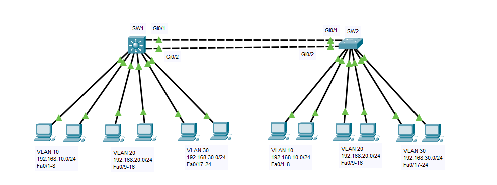

# EtherChannel - Agregace Linek (LACP)

Tento projekt se zaměřuje na konfiguraci **EtherChannelu** pomocí protokolu **LACP (Link Aggregation Control Protocol)**. Tato technologie umožňuje spojit více fyzických linek do jedné logické, čímž se zvyšuje šířka pásma a zajišťuje redundance na úrovni L2.

## Popis Topologie

Topologie se skládá ze dvou přepínačů (**SW1** a **SW2**) propojených dvěma gigabitovými linkami (G0/1 a G0/2). Tyto linky jsou agregovány do virtuálního rozhraní **Port-Channel 1**. 

*   **SW1:** Funguje jako Layer 3 switch (má zapnuté směrování) a slouží jako výchozí brána pro jednotlivé VLANy.
*   **SW2:** Funguje jako standardní Layer 2 switch.

Síť je rozdělena do tří VLAN (10, 20, 30) pro různé skupiny uživatelů/zařízení.



## Klíčové Vlastnosti

*   **LACP (802.3ad):** Použit standardizovaný protokol pro agregaci linek v aktivním režimu (`mode active`).
*   **Zvýšená propustnost:** Logická linka má kapacitu 2 Gbps díky spojení dvou 1 Gbps rozhraní.
*   **Redundance:** Při výpadku jednoho z fyzických kabelů zůstává spojení aktivní přes zbývající linku bez nutnosti přepočítávání Spanning Tree (STP).
*   **Trunking:** Port-Channel je nastaven jako Trunk, který přenáší provoz všech definovaných VLAN.
*   **Inter-VLAN Routing:** SW1 zajišťuje směrování mezi VLANami pomocí SVI (Switch Virtual Interfaces).
*   **STP PortFast & BPDU Guard:** Koncové porty jsou optimalizovány pro rychlé připojení a chráněny proti nechtěným smyčkám.

## Adresní Plán (VLAN)

| VLAN | Název | IPv4 Síť | Brána (SW1) |
| :--- | :--- | :--- | :--- |
| 10 | VLAN-10 | 192.168.10.0/24 | 192.168.10.1 |
| 20 | VLAN-20 | 192.168.20.0/24 | 192.168.20.1 |
| 30 | VLAN-30 | 192.168.30.0/24 | 192.168.30.1 |

## Konfigurace EtherChannelu (Ukázka)

```text
interface range GigabitEthernet 0/1 - 2
 channel-group 1 mode active

interface Port-Channel 1
 switchport trunk encapsulation dot1q
 switchport mode trunk
 switchport trunk allowed vlan 10,20,30
```

## Ověření funkčnosti

Pro kontrolu stavu agregace linek lze použít:

*   `show etherchannel summary` - Rychlý přehled o stavu Port-Channelu a zapojených portech (status 'P' značí úspěšné zapojení).
*   `show interfaces port-channel 1` - Informace o logickém rozhraní.
*   `show spanning-tree` - Ověření, že STP vidí Port-Channel jako jednu linku a neblokuje jednotlivé fyzické porty.

---

**Poznámka:** Tato topologie se soustředí na technologii EtherChannel a základní L3 přepínání. Bezpečnostní prvky (mimo BPDU Guard) nejsou předmětem tohoto labu.
