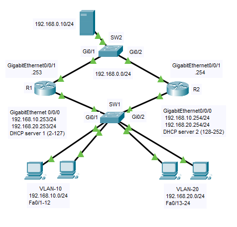

# FHRP - Redundance výchozí brány (HSRP)

Tento projekt demonstruje implementaci protokolu **HSRP (Hot Standby Router Protocol)**, který patří do rodiny FHRP (First Hop Redundancy Protocol). Cílem je zajistit vysokou dostupnost (High Availability) výchozí brány pro koncová zařízení v síti.

## Popis Topologie

Topologie využívá dva směrovače (**R1** a **R2**), které vystupují pro koncová zařízení jako jedna virtuální brána. V případě výpadku primárního směrovače (Active) přebírá jeho roli záložní směrovač (Standby), aniž by uživatelé zaznamenali výpadek konektivity.

Síť je rozdělena do dvou VLAN:
*   **VLAN 10:** Provozní síť 1.
*   **VLAN 20:** Provozní síť 2.

Směrovače jsou propojeny s přepínačem **SW1** pomocí trunků (Router-on-a-Stick).



## Klíčové Vlastnosti

*   **HSRP (Hot Standby Router Protocol):** Cisco proprietární protokol pro redundanci brány.
*   **Aktivní/Záložní režim:** 
    *   **R1** je nastaven jako **Active** router díky vyšší prioritě (150).
    *   **R2** je nastaven jako **Standby** router (priorita 100).
*   **Preemption:** Povoleno na obou směrovačích, což zajišťuje, že se R1 po restartu opět stane aktivním.
*   **Redundantní DHCP:** Oba směrovače slouží jako DHCP servery s rozděleným rozsahem adres (Split Scope), aby byla zajištěna distribuce IP i při výpadku jednoho z nich.
*   **Rapid Spanning Tree (PVRST+):** Zajišťuje rychlou konvergenci na vrstvě L2.

## Adresní Plán

| Síť / Rozhraní | Virtuální IP (HSRP) | IP R1 (G0/0/0.x) | IP R2 (G0/0/0.x) |
| :--- | :--- | :--- | :--- |
| **VLAN 10** | 192.168.10.1 | 192.168.10.253 | 192.168.10.254 |
| **VLAN 20** | 192.168.20.1 | 192.168.20.253 | 192.168.20.254 |
| **ISP Link (G0/0/1)** | 192.168.0.1 | 192.168.0.253 | 192.168.0.254 |

## Konfigurace HSRP (Ukázka R1)

```text
interface GigabitEthernet 0/0/0.10
 encapsulation dot1Q 10
 ip address 192.168.10.253 255.255.255.0
 standby 10 ip 192.168.10.1
 standby 10 priority 150
 standby 10 preempt
```

## Ověření funkčnosti

Pro kontrolu stavu HSRP a redundance lze použít:

*   `show standby brief` - Zobrazí aktuální stav (Active, Standby, Virtual IP).
*   `show standby` - Detailní informace o HSRP skupinách a časovačích.
*   **Test výpadku:** Vypnutí rozhraní na R1 (`shutdown`) a sledování, zda R2 převezme roli Active a udrží konektivitu (ping).

---

**Poznámka:** Tato topologie byla vytvořena primárně za účelem demonstrace redundance na první skoku (FHRP/HSRP). Záměrem nebylo řešit komplexní bezpečnostní politiky nebo pokročilé směrování.
