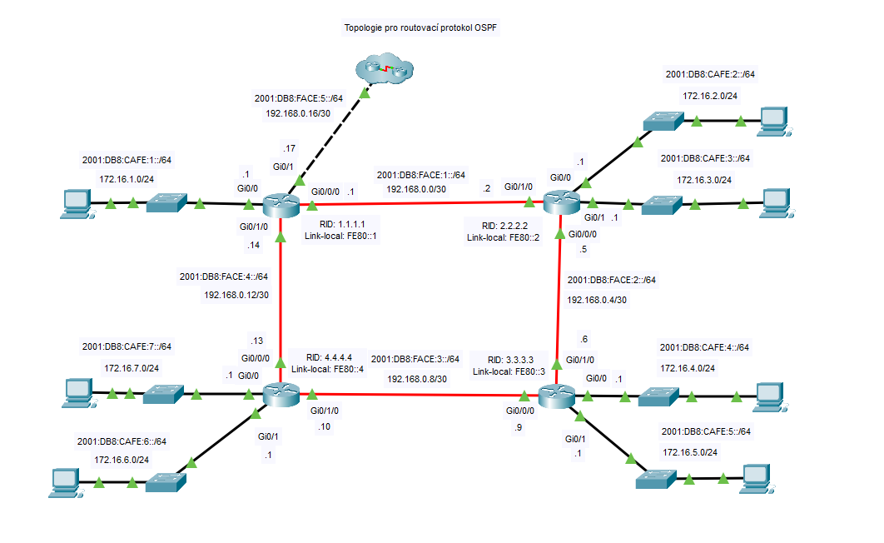

# OSPF Dynamické Směrování (Dual-Stack IPv4/IPv6)

Tato část portfolia se zaměřuje na konfiguraci dynamického směrovacího protokolu OSPF v prostředí s duálním zásobníkem (Dual-Stack) pro protokoly IPv4 (OSPFv2) a IPv6 (OSPFv3).

## Popis Topologie

Topologie se skládá ze čtyř směrovačů (R1, R2, R3, R4) zapojených do kruhu, což zajišťuje redundanci v případě výpadku jedné z linek. Směrovač R1 slouží jako hraniční router (Edge Router) a poskytuje připojení k simulovanému internetu (ISP).

Všechny vnitřní linky mezi směrovači jsou nakonfigurovány jako sítě typu **point-to-point**, což urychluje konvergenci OSPF, protože není nutná volba DR/BDR (Designated Router).



## Klíčové Vlastnosti

*   **OSPFv2 & OSPFv3:** Plná podpora dynamického směrování pro IPv4 i IPv6 v jediné oblasti (Area 0 - Backbone).
*   **Redundance:** Kruhové zapojení umožňuje provoz sítě i při výpadku jedné propojovací linky.
*   **Propagace výchozí cesty:** R1 automaticky propaguje výchozí cestu (default route) do zbytku sítě pomocí příkazu `default-information originate`.
*   **Zabezpečení a efektivita:** LAN rozhraní jsou nastavena jako **passive-interface**, aby se zabránilo odesílání OSPF paketů do koncových sítí a snížila se režie procesoru.
*   **Dual-Stack DHCP:** Každý směrovač poskytuje adresy koncovým zařízením pomocí DHCPv4 a DHCPv6.

## Adresní Plán

### Propojovací linky (Inter-Router Links)

| Linka | IPv4 Subnet | IPv6 Prefix |
| :--- | :--- | :--- |
| R1 - R2 | 192.168.0.0/30 | 2001:DB8:FACE:1::/64 |
| R2 - R3 | 192.168.0.4/30 | 2001:DB8:FACE:2::/64 |
| R3 - R4 | 192.168.0.8/30 | 2001:DB8:FACE:3::/64 |
| R4 - R1 | 192.168.0.12/30 | 2001:DB8:FACE:4::/64 |
| R1 - ISP | 192.168.0.16/30 | 2001:DB8:FACE:5::/64 |

### Lokální sítě (LAN)

| Směrovač | LAN | IPv4 Síť | IPv6 Prefix |
| :--- | :--- | :--- | :--- |
| R1 | LAN 1 | 172.16.1.0/24 | 2001:DB8:CAFE:1::/64 |
| R2 | LAN 2 | 172.16.2.0/24 | 2001:DB8:CAFE:2::/64 |
| R2 | LAN 3 | 172.16.3.0/24 | 2001:DB8:CAFE:3::/64 |
| R3 | LAN 4 | 172.16.4.0/24 | 2001:DB8:CAFE:4::/64 |
| R3 | LAN 5 | 172.16.5.0/24 | 2001:DB8:CAFE:5::/64 |
| R4 | LAN 6 | 172.16.6.0/24 | 2001:DB8:CAFE:6::/64 |
| R4 | LAN 7 | 172.16.7.0/24 | 2001:DB8:CAFE:7::/64 |

## Konfigurace OSPF

### Směrovač R1 (Ukázka)
```text
router ospf 1
 router-id 1.1.1.1
 network 172.16.1.0 0.0.0.255 area 0
 network 192.168.0.0 0.0.0.3 area 0
 network 192.168.0.12 0.0.0.3 area 0
 passive-interface GigabitEthernet0/0
 default-information originate

ipv6 router ospf 1
 router-id 1.1.1.1
 passive-interface GigabitEthernet0/0
 default-information originate
```

## Ověření funkčnosti

Pro ověření správné funkce směrování lze použít následující příkazy:

*   `show ip ospf neighbor` / `show ipv6 ospf neighbor` - Kontrola sousedství s ostatními routery.
*   `show ip route ospf` / `show ipv6 route ospf` - Kontrola naučených cest v routovací tabulce.
*   `ping` / `traceroute` - Ověření konektivity napříč celou topologií i do internetu.

---

**Poznámka:** Tato topologie byla vytvořena primárně za účelem demonstrace a procvičení konfigurace dynamického směrování OSPF (Dual-Stack). Záměrem nebylo řešit zabezpečení sítě (firewall, ACL, autentizace směrování apod.), což by v reálném nasazení bylo nezbytným krokem.
