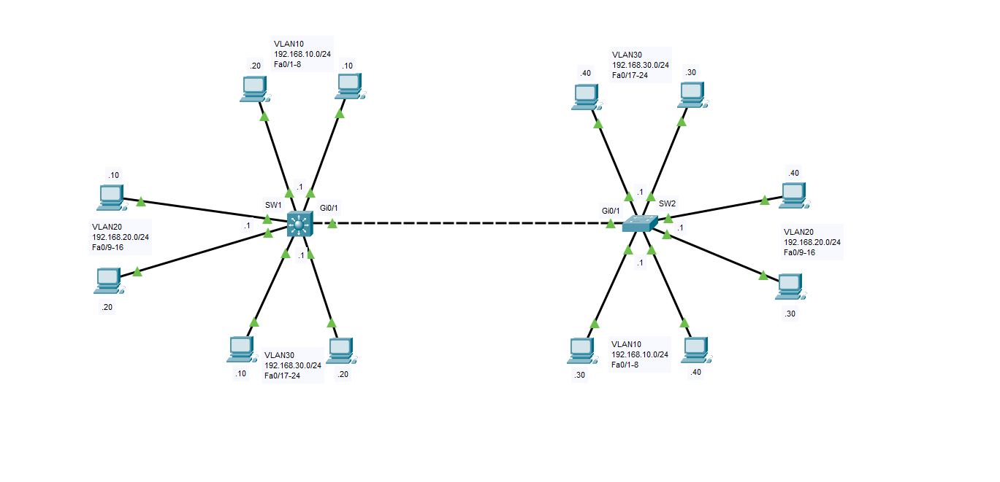

# VLAN a Inter-VLAN Routing

Tato část portfolia se zaměřuje na konfiguraci virtuálních místních sítí (**VLAN**) a jejich vzájemné propojení pomocí směrování na 3. vrstvě (**Inter-VLAN Routing**) na L3 přepínači.

## Topologie

Topologie se skládá ze dvou přepínačů propojených pomocí **Trunku**. 

- **SW1 (Layer 3 Switch):** Slouží jako centrální prvek sítě, který spravuje VLAN a zajišťuje směrování mezi nimi (Inter-VLAN Routing) pomocí SVI rozhraní.
- **SW2 (Layer 2 Switch):** Slouží k rozšíření přístupových portů pro koncová zařízení v rámci definovaných VLAN.

## Konfigurace VLAN

V síti jsou definovány tři VLAN, které logicky oddělují provoz:

| VLAN ID | Název | Rozsah portů | IP Subnet | Výchozí brána (SVI na SW1) |
| :--- | :--- | :--- | :--- | :--- |
| **10** | VLAN-10 | Fa0/1 - Fa0/8 | 192.168.10.0/24 | 192.168.10.1 |
| **20** | VLAN-20 | Fa0/9 - Fa0/16 | 192.168.20.0/24 | 192.168.20.1 |
| **30** | VLAN-30 | Fa0/17 - Fa0/24 | 192.168.30.0/24 | 192.168.30.1 |

## Klíčové technologie

### Trunking (802.1Q)
Propojení mezi SW1 a SW2 je realizováno na portech **Gi0/1**. Tento spoj je konfigurován jako **Trunk**, což umožňuje přenos provozu všech tří VLAN (10, 20, 30) přes jeden fyzický kabel s využitím tagování dle standardu IEEE 802.1Q.

### Inter-VLAN Routing
Směrování mezi sítěmi zajišťuje SW1. Díky zapnutému příkazu `ip routing` a vytvořeným virtuálním rozhraním (`interface vlan 10`, atd.) mohou zařízení z jedné VLAN komunikovat se zařízeními v jiné VLAN, pokud je to povoleno.

## Soubory v této složce
- `vlany.pkt`: Soubor projektu pro Cisco Packet Tracer.
- `topologie.png`: Grafické znázornění zapojení.
- `konfigurace/sw1.txt`: Detailní výpis příkazů pro L3 switch SW1.
- `konfigurace/sw2.txt`: Detailní výpis příkazů pro L2 switch SW2.

## Poznámka
Záměrem tohoto projektu je pouze ukázat konfiguraci VLAN a Inter-VLAN routing. Bezpečnost (např. zabezpečení portů, ACL atd.) zde nebyla v záměru.